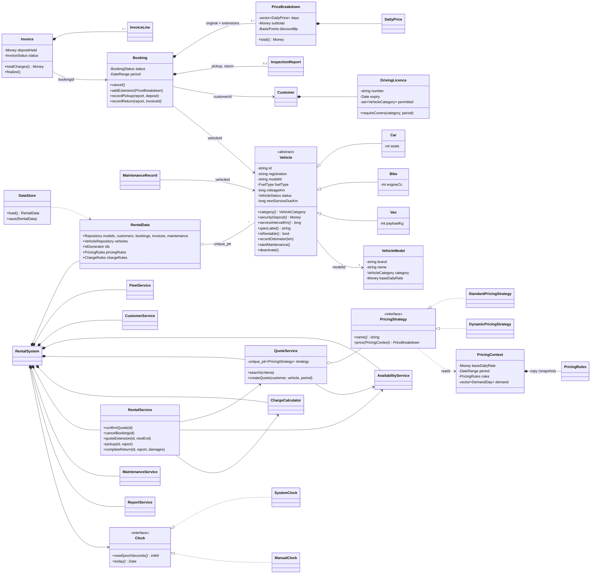

# Design

## 1. System summary

Staff use a console menu to manage **vehicle models** (brand, model, category,
base daily rate) and the **vehicles** that belong to them (cars, bikes, vans),
register **customers** with synthetic driving licences, search availability,
produce **price quotes** that expire after 15 minutes, and turn a valid quote
into a **booking**. A booking is collected (pickup inspection, deposit),
optionally extended, and returned (return inspection, extra charges), which
produces a finalized **invoice**. **Maintenance** records block a vehicle while
open; separate **service warnings** flag vehicles near their next service.
Everything is saved to one versioned text file after each change.

## 2. Architecture

```
        +------------------------------ app/ ---------------------------------+
        |  main.cpp  ->  ConsoleApp (menus)  ->  ConsoleIO (input, tables)      |
        +------------------------------------|---------------------------------+
                                             | calls services, prints results
        +------------------------------------v---------------------------------+
        |  RentalSystem (composition root: owns data, builds services)          |
        |                                                                        |
        |  FleetService  CustomerService  QuoteService  RentalService            |
        |  AvailabilityService  ChargeCalculator  MaintenanceService  Reports    |
        +------------------------------------|---------------------------------+
                                             | read / change
        +------------------------------------v---------------------------------+
        |  RentalData: Repositories (models, vehicles, customers, bookings,      |
        |              invoices, maintenance) + IdGenerator + rules              |
        +------------------------------------|---------------------------------+
                                             | save / load
                                   DataStore (data/rental_data.txt)
```

Rules for the layers:

* **The UI holds no business rules.** `ConsoleApp` asks for input, calls one
  service method and prints the result. If a rule is broken, the service throws
  (`ValidationError`, `ConflictError`, `NotFoundError`) and the menu prints the
  message. You could replace the console with a GUI without touching `src/`.
* **Each service has one job**; there is no "manager" class doing everything.
* **Objects refer to each other by ID** (a booking stores `"V-0003"`, not a
  pointer). This makes saving trivial and avoids dangling pointers.
* **Time comes from a `Clock`**, so tests can move time forward instantly.

## 3. Main classes and why they exist

| Class | Responsibility | Relationships |
|---|---|---|
| `Money` | Integer paise, rounding, INR formatting | value object used everywhere |
| `Date`, `DateRange` | Validated calendar dates; `[start, end)` periods, overlap test | value objects |
| `VehicleModel` | Brand, model name, category, base daily rate | many vehicles share one model (by `modelId`) |
| `Vehicle` *(abstract)* | Registration, fuel, odometer, status, service threshold | base of Car/Bike/Van |
| `Car`, `Bike`, `Van` | Category-specific deposit, service interval and attribute (seats / engine cc / payload) | `final` derived classes |
| `DrivingLicence` | Number, expiry, permitted categories; "does it cover this rental?" | value object inside `Customer` |
| `Customer` | Contact details + licence | referenced by bookings |
| `PricingRules` | Configurable tiers, factors, cap, discounts, holidays, quote validity | owned by `RentalData` |
| `PricingContext` | Snapshot: base rate, copied rules, per-day demand | input to a strategy |
| `PricingStrategy` *(interface)* | `price(context) -> PriceBreakdown` | implemented by Standard and Dynamic |
| `PriceBreakdown`, `DailyPrice` | Per-day factors, reasons and amounts; subtotal, discount, total | **composed** into `Booking` |
| `Booking` | Status state machine, price parts, inspections, deposit | owns breakdowns + reports |
| `InspectionReport` | Date, odometer, fuel %, notes | **composed** into `Booking` |
| `Invoice`, `InvoiceLine` | Itemised charges, separate deposit, Draft/Finalized | owns its lines |
| `MaintenanceRecord` | Open/completed task for one vehicle | references vehicle by ID |
| `Repository<T>`, `VehicleRepository` | Own the objects, look up by ID, reject duplicates | inside `RentalData` |
| `IdGenerator` | Persistent counters: V-0001, B-0001, ... | inside `RentalData` |
| `AvailabilityService` | Overlap checks and per-day model demand | used by quotes, rentals, maintenance |
| `QuoteService` | Search, build snapshot, call strategy, hold pending quotes | holds `unique_ptr<PricingStrategy>` |
| `RentalService` | Confirm quote, cancel, extend, pickup, return | uses Availability, Quote, ChargeCalculator |
| `ChargeCalculator` + `ChargeRules` | Rental lines, late / mileage / fuel / damage charges | used by RentalService |
| `MaintenanceService` | Open (block) / complete (unblock), service warnings | |
| `ReportService` | Read-only reports | |
| `DataStore` | Versioned file format, safe save, validated load | reads/writes `RentalData` |
| `Clock` *(interface)* | Current time/date: `SystemClock` or `ManualClock` | injected into services |

## 4. Class diagram



## 5. How the objects collaborate: "confirm a booking"

1. `ConsoleApp::createQuote` reads customer, vehicle and dates, then calls
   `QuoteService::createQuote`.
2. `QuoteService` checks the date is not in the past, asks the customer's
   `DrivingLicence` to `requireCovers(category, period)`, and asks
   `AvailabilityService::requireAvailable` (vehicle Active, no overlapping
   Confirmed/Active booking).
3. It builds a `PricingContext`: the model's base rate, a **copy** of the
   `PricingRules`, and `AvailabilityService::modelDemand` for each day. The
   proposed booking does not exist yet, so it is never counted as demand.
4. It calls `strategy_->price(context)` - a **virtual call**; the dynamic or
   standard strategy runs depending on the object behind the pointer.
5. The quote (with `createdAt`/`expiresAt`) is stored as pending and printed.
6. On confirmation, `RentalService::confirmQuote` removes the quote, rejects it
   if `now >= expiresAt`, re-checks licence and availability, and stores a new
   `Booking` that **contains the quoted `PriceBreakdown`**. The price is honoured
   even if demand has risen since, and later rule changes cannot alter it.

## 6. OOP principles mapped to the code

| Principle | Where in the code | Why it matters here |
|---|---|---|
| **Encapsulation** | All domain classes keep data `private`. `Vehicle::recordOdometer` refuses to go backwards; `Booking::cancel()` only works when Confirmed; `Invoice::addLine` only while Draft; `Customer::updateContact` validates all fields before changing any. | Invalid states (negative mileage, a cancelled-then-collected booking) cannot be created, whoever calls the class. |
| **Abstraction** | `Vehicle` (pure virtual `category()`, `securityDeposit()`, `serviceIntervalKm()`, ...), `PricingStrategy`, `Clock`. | Callers depend on *what* an object can do, not *how*. `QuoteService` only knows "a pricing strategy". |
| **Inheritance** | `Car`, `Bike`, `Van` : `Vehicle`. Brands are **data** (`VehicleModel`), not subclasses. Exceptions: `ValidationError`, `ConflictError`... : `RentalError`. | Inheritance is used only where behaviour truly differs (deposit, service interval, extra attribute). |
| **Runtime polymorphism** | `vehicle.securityDeposit()` at pickup; `vehicle.serviceIntervalKm()` when maintenance completes; `strategy_->price(ctx)` in `QuoteService`; `clock_.today()`; `makeVehicle()` factory rebuilding the right type when loading. | New behaviour (e.g. a `Truck` or a `LoyaltyPricingStrategy`) is added by writing a new class, not by editing `if/else` chains. |
| **Composition** | `Booking` owns its `PriceBreakdown`s and `InspectionReport`s; `Invoice` owns `InvoiceLine`s; `Customer` owns `DrivingLicence`; `RentalSystem` owns `RentalData` and all services. | The parts have no life of their own and are saved with their owner. |
| **RAII & ownership** | `std::unique_ptr<Vehicle>` in `VehicleRepository`; `std::unique_ptr<PricingStrategy>` in `QuoteService`; file streams closed by scope; `TempDir` in tests. No `new`/`delete` anywhere. | No leaks, clear single owner, polymorphic objects deleted through the `virtual ~Vehicle()`. |
| **const correctness** | Query methods are `const`; services that only read take `const RentalData&` (`AvailabilityService`, `ReportService`). | The compiler proves reports cannot modify data. |
| **enum class** | `VehicleCategory`, `FuelType`, `VehicleStatus`, `BookingStatus`, `MaintenanceStatus`, `InvoiceStatus`, `ChargeType`. | No accidental mixing with integers. |

**Simplifications from the suggested design (with justification):**
`PriceQuote` is a plain struct in `QuoteService.h` rather than a class, because
it has no behaviour beyond `isExpired()`. Repositories are in-memory classes and
a single `DataStore` handles the file, instead of one file-backed repository per
entity: one file can be replaced atomically, while six files could end up
half-saved and inconsistent.

## 7. Dynamic pricing

### Rules (all stored in `PricingRules`, all configurable)

For each billed day *d* of the requested period:

1. **Utilization** of the *model* on day *d* =
   `booked / capacity`, where
   * `capacity` = vehicles of that model whose status is **Active** (vehicles under
     maintenance or inactive are excluded),
   * `booked` = Confirmed + Active bookings on those vehicles that cover *d*
     (cancelled and completed bookings excluded; the customer's own proposed
     booking is not counted; when extending, the booking being extended is excluded).
   * `capacity = 0` gives a neutral **1.00x** factor (no division by zero).
2. **Demand factor**: tier with the highest threshold `<=` utilization.
   Compared exactly with integers: `booked x 10000 >= threshold_bp x capacity`.
3. **Calendar factor**: weekend (Sat/Sun) 1.10, holiday 1.15, **max of the two**
   if both, otherwise 1.00.
4. **Applied factor** = min(demand x calendar, 1.40).
5. **Daily amount** = base rate x applied factor, rounded half away from zero to
   the paisa.
6. **Subtotal** = sum of daily amounts. **Discount** = subtotal x the highest
   eligible duration discount (7-29 days 10%, 30+ days 20%), rounded the same way.
   **Total** = subtotal - discount.

The demand for all days is read once into the `PricingContext` before any
calculation, so the quote is computed from one consistent snapshot.

### How multipliers stay exact

Factors are basis points: `1.15 -> 11500`. Multiplying two factors:
`12500 x 11500 / 10000 = 14375` (1.4375). Applying a factor to money:
`350000 paise x 14000 / 10000 = 490000 paise`. Division uses
`divideRounded()` (half away from zero). Everything is 64-bit integer arithmetic,
so the same inputs always give the same paisa on every platform.

### Worked example (locked in by a unit test)

Toyota Innova (base **INR 3,500/day**), fleet of 2 Innovas, rental
**Thu 2026-12-24 -> Thu 2026-12-31** (7 billed days). 2026-12-25 is a configured
holiday. The *other* Innova is already booked for Sat 26 and Sun 27.

| Day | Booked/cap | Demand | Calendar | Demand x calendar | Applied | Amount (INR) |
|---|---|---|---|---|---|---|
| Thu 24 | 0/2 (0%) | 0.90 | 1.00 weekday | 0.90 | 0.90 | 3,150.00 |
| Fri 25 | 0/2 (0%) | 0.90 | 1.15 holiday | 1.035 | 1.035 | 3,622.50 |
| Sat 26 | 1/2 (50%) | 1.00 | 1.10 weekend | 1.10 | 1.10 | 3,850.00 |
| Sun 27 | 1/2 (50%) | 1.00 | 1.10 weekend | 1.10 | 1.10 | 3,850.00 |
| Mon 28 | 0/2 (0%) | 0.90 | 1.00 | 0.90 | 0.90 | 3,150.00 |
| Tue 29 | 0/2 (0%) | 0.90 | 1.00 | 0.90 | 0.90 | 3,150.00 |
| Wed 30 | 0/2 (0%) | 0.90 | 1.00 | 0.90 | 0.90 | 3,150.00 |
| | | | | | **Subtotal** | **23,922.50** |
| | | | | | 10% duration discount (7 days) | -2,392.25 |
| | | | | | **Total** | **21,530.25** |

The test `pricing: the worked example in docs/DESIGN.md ...` checks every number.

**Cap example:** if 9 of 10 vehicles of a model are booked (90% -> 1.25) on a
holiday (1.15), demand x calendar = 1.4375, which is capped to **1.40**:
Innova costs 3,500 x 1.40 = **INR 4,900** that day. On a plain weekend the same
demand gives 1.25 x 1.10 = 1.375, under the cap: INR 4,812.50.

### Quotes, confirmation and extensions

* A quote stores the full breakdown, `createdAt` and `expiresAt = createdAt + 15 min`.
  It is expired from the exact expiry second (`now >= expiresAt`).
* Confirmation rejects an expired quote, re-checks availability and licence, and
  then stores the **quoted** breakdown in the booking (honoured even if demand
  changed). The booking never looks at the current rates again.
* An extension prices only the new days `[old return, new return)`, with demand
  that excludes the booking itself, and applies the duration discount based on
  the number of extension days. The customer sees the additional amount before
  confirming. It is stored as an extra `PriceBreakdown` in the booking.
* `StandardPricingStrategy` (flat base rate + duration discount) can be switched
  on from *Pricing settings* to demonstrate polymorphism.

## 8. Booking state machine and charges

```
 quote --confirm--> Confirmed --pickup--> Active --return--> Completed (+ Invoice)
                        |                    |
                        +--cancel--> Cancelled
                        +--extend--+         +--extend--+
```

* **Pickup**: booking Confirmed, pickup date inside the booking period, vehicle
  Active (not under maintenance) and not still out with someone else, licence
  re-checked, odometer not below the vehicle's record. Deposit = the vehicle's
  `securityDeposit()`.
* **Return**: return date not before pickup, odometer not below pickup. Staff see
  a **draft invoice preview**, then confirm; only then is anything saved.
* **Charges**: late days = max(0, return date - agreed return date) x 1.5 x the
  booking's original base rate; free km = per-day allowance x (billed days + late
  days); fuel = missing percentage points x per-point rate; damage = manual lines.

## 9. Persistence format (version 1)

One UTF-8 text file, one record per line, TAB-separated fields. Real lines from
a demo file (`<TAB>` shown for readability; the last BOOKING field is empty
because no invoice exists yet):

```
SVRMS-DATA<TAB>1
COUNTER<TAB>B<TAB>8
PRULE<TAB>weekend<TAB>11000
PTIER<TAB>3000<TAB>10000
HOLIDAY<TAB>2026-12-25
MODEL<TAB>M-0001<TAB>Maruti<TAB>Swift<TAB>Car<TAB>150000
VEHICLE<TAB>V-0001<TAB>Car<TAB>DM01SW0001<TAB>M-0001<TAB>Petrol<TAB>9500<TAB>Active<TAB>19500<TAB>5
CUSTOMER<TAB>C-0001<TAB>Aarav Sharma<TAB>+91 90000 00101<TAB>aarav.demo@example.com<TAB>DEMO-DL-0001<TAB>2030-06-30<TAB>Car,Bike
BOOKING<TAB>B-0003<TAB>C-0001<TAB>V-0001<TAB>Active<TAB>1794128400<TAB>500000<TAB>
PRICE<TAB>B-0003<TAB>0<TAB>2026-11-08<TAB>2026-11-13<TAB>Dynamic<TAB>150000<TAB>0<TAB>688500<TAB>688500
PDAY<TAB>B-0003<TAB>0<TAB>2026-11-08<TAB>0<TAB>4<TAB>9000<TAB>0/4 booked (0.0%) -> tier >= 0%<TAB>11000<TAB>weekend<TAB>9900<TAB>0<TAB>148500
INSPECT<TAB>B-0003<TAB>PICKUP<TAB>2026-11-08<TAB>9500<TAB>100<TAB>Clean
...
END<TAB>101
```

Record layouts: `MODEL id brand name category ratePaise` ·
`VEHICLE id category registration modelId fuel odometer status nextServiceKm spec` ·
`CUSTOMER id name phone email licence expiry categories` ·
`BOOKING id customer vehicle status createdAtEpoch depositPaise invoiceId` ·
`PRICE booking part start end strategy basePaise discountBp subtotalPaise totalPaise` ·
`PDAY booking part date booked capacity demandBp demandReason calendarBp calendarReason appliedBp capped amountPaise` ·
`INSPECT booking PICKUP|RETURN date odometer fuel% notes` ·
`INVOICE id booking customer vehicle issueDate depositPaise status` ·
`INVLINE invoice type description amountPaise` ·
`MAINT id vehicle status description opened odometer closed serviceKm costPaise` ·
plus `COUNTER`, `PRULE`, `PTIER`, `PDISC`, `HOLIDAY`, `CRULE`, `CCAT`, `SETTING`.

* **Versioned**: the header carries the format version; a newer version is refused.
* **Escaping**: `\` -> `\\`, TAB -> `\t`, newline -> `\n`, CR -> `\r`, so notes and
  names can contain anything. Unknown escapes are reported as corruption.
* **Types**: money in paise, factors in basis points, dates `YYYY-MM-DD`;
  `VEHICLE` carries the category so `makeVehicle()` rebuilds a `Car`, `Bike` or `Van`.
* **Validation on load**: field counts, numbers, enums, dates; every reference
  (vehicle -> model, booking -> customer/vehicle, invoice -> booking, maintenance ->
  vehicle); booking history is **replayed through `Booking`'s own methods**, so an
  impossible history (e.g. a cancelled booking with a pickup) is rejected; stored
  price totals must match the daily lines; no two open bookings may overlap on one
  vehicle; vehicle status must match open maintenance; the `END` count must match.
  Any problem -> `PersistenceError` naming the line, and the file is left untouched.
* **IDs**: counters are saved, and on load each counter is raised to at least the
  largest ID found, so IDs are never reused.
* **Safe save**: write `rental_data.txt.tmp`, read it back, rename the current file
  to `.bak`, rename `.tmp` into place. If the program dies between the two renames,
  startup finds only the `.bak` and tells the user how to restore it.
  Platform note: on POSIX `rename` is atomic; on Windows the two steps are not one
  atomic operation, which is exactly why the `.bak` is kept. No `fsync` is done,
  so a power cut at the wrong moment could still lose the very latest write.
* **Single process**: no locking; run one instance per data file.
* **Seed data** is created only by `--seed-demo` into a new file.
