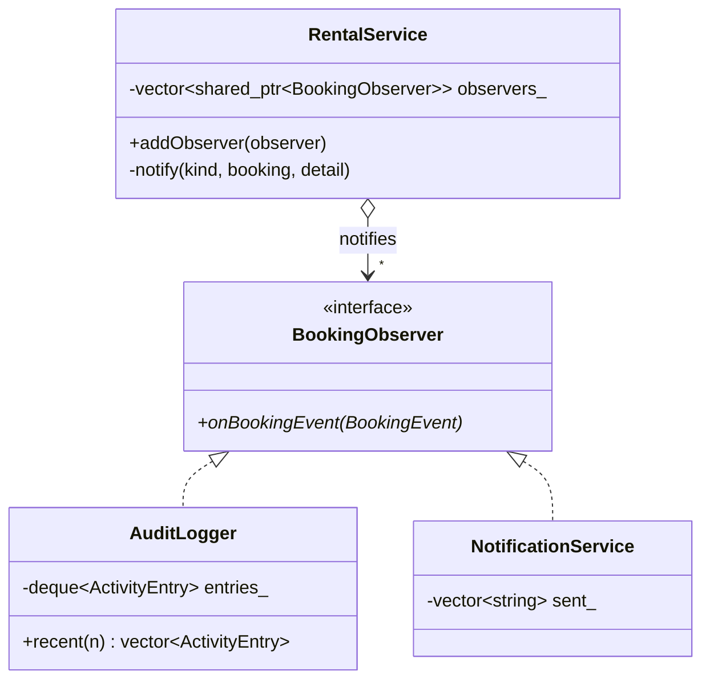
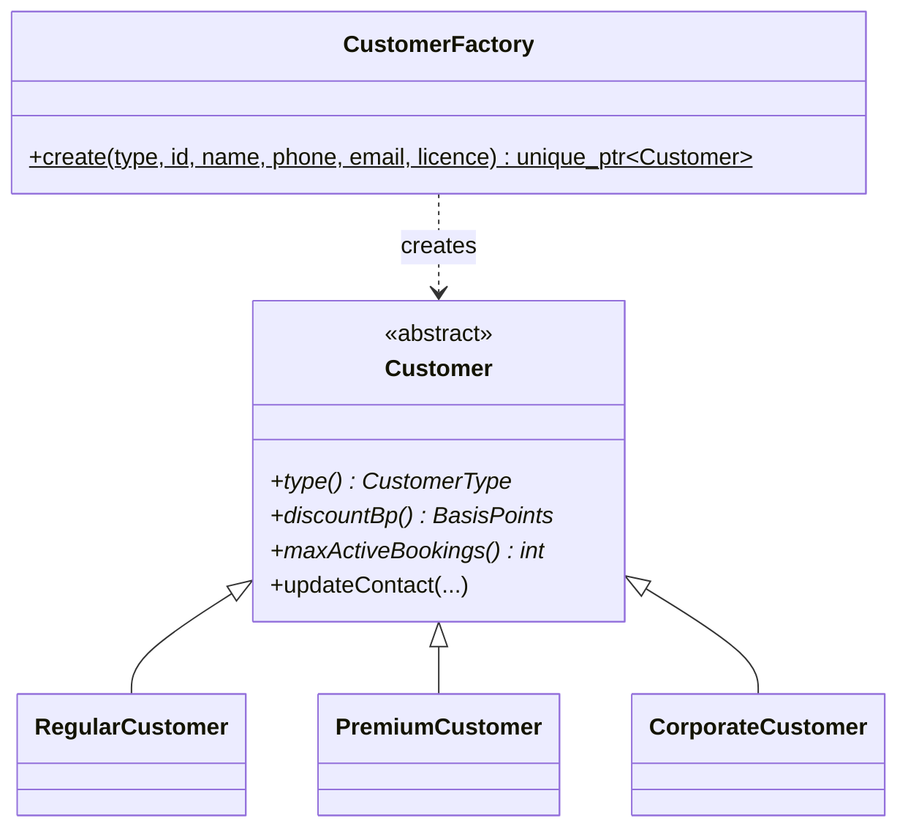

# OOP extensions: Observer, Customer hierarchy, Factory

Three additions that put named OOP concepts into the code, all visible in the web demo.
Every one is covered by tests in `tests/test_oop_extras.cpp`.

| Addition | Pattern / concept | Main files |
|---|---|---|
| Audit log + SMS messages when a booking changes | **Observer** (loose coupling, interface) | `BookingObserver.h`, `AuditLogger.*`, `NotificationService.*`, `RentalService.*` |
| Regular / Premium / Corporate customers | **Inheritance + polymorphism**, abstract base class | `Customer.h/.cpp`, `Repository.*` (`CustomerRepository`) |
| Creating the right Customer / Vehicle subclass | **Factory** (registry, Open/Closed) | `CustomerFactory` in `Customer.*`, `VehicleFactory` in `VehicleTypes.*` |

## 1. Observer: booking events

* `RentalService` is the **subject**. After a booking is confirmed, extended, picked up, returned or cancelled it builds a `BookingEvent` and calls `onBookingEvent` on every registered observer.
* `RentalService` does not know what its observers do. To add e-mail alerts you write one new class and call `addObserver`; nothing existing changes (**Open/Closed**).
* Events are sent only **after** the action succeeded. A rejected action sends nothing.
* A broken observer is caught and ignored, so it can never undo or break a rental.
* `AuditLogger` appends to `data/audit_log.txt` and feeds the dashboard's **Recent activity** panel.
* `NotificationService` prints a simulated `[SMS to +91 ...]` line in the server terminal.

## 2. Customer hierarchy

| Kind | Discount on every quote | Open bookings allowed |
|---|---|---|
| Regular | none | 5 |
| Premium | 5% | 8 |
| Corporate | 10% | 20 |

* The three virtual functions are the only place the kinds differ. `QuoteService` calls `customer.discountBp()` and `RentalService` calls `customer.maxActiveBookings()`; neither ever checks "which kind is this?" (**polymorphism**).
* The discount is **added** to the duration discount (`PriceBreakdown::applyCustomerDiscount`), so it is stored and reloaded with the booking like any other price part.
* `Customer` copying is deleted (copying a base reference would **slice** the object), and its constructor is `protected` so only the subclasses can create one.
* Customers are stored through `unique_ptr` in `CustomerRepository`, exactly like vehicles.
* **File format:** the `CUSTOMER` line gets a 9th field (the kind). Older 8-field files still load; those customers become Regular.

## 3. Factory

* `CustomerFactory::create(type, ...)` returns the right customer subclass. Used by `CustomerService` and when loading the data file.
* `VehicleFactory` keeps a **registry**: a map from `VehicleCategory` to a creator function. `FleetService` and `DataStore` call `VehicleFactory::instance().create(...)` and never name `Car`, `Bike` or `Van`.
* A new kind of vehicle can be added with `registerCreator(...)` without editing existing code (a test does exactly this).

## Demo script (website)

1. Customers -> **Add a customer** -> choose **Premium** or **Corporate**. The list shows the type and discount.
2. Book the same vehicle and dates for a Regular and a Premium customer: the Premium price is lower.
3. Keep booking for a Regular customer until the limit is reached: the website shows the limit message.
4. Use **Update** on a booking (Confirmed -> Active -> Completed). The dashboard's **Recent activity** panel fills in, the server terminal prints a simulated SMS, and `data/audit_log.txt` grows.

## Likely viva questions

* **Why is `Customer` abstract?** There is no sensible "generic" customer. Each kind must decide its own discount and limit, so the base class forces that with pure virtual functions.
* **Where is polymorphism used?** `customer.discountBp()` and `customer.maxActiveBookings()`; `vehicle.securityDeposit()`; `observer->onBookingEvent(...)`.
* **Why Observer instead of calling the logger directly?** `RentalService` stays unaware of logging or SMS. Adding behaviour does not modify it (loose coupling, Open/Closed).
* **Why is `Customer` non-copyable?** Copying through a base reference would slice off the derived part. Objects live in the repository and are used by reference.
* **What does the factory buy you?** Callers do not depend on concrete classes. Adding a type means registering one creator.
